# Lukla Operations Engine — Database Architecture & Seeder Guide

Dokumen ini menyajikan spesifikasi arsitektur basis data relasional **PostgreSQL 16** untuk **Lukla Operations Engine**, mencakup diagram relasi entitas (*Entity-Relationship Diagram*), definisi struktur tabel per domain, serta katalog data *seeder* bawaan beserta peruntukan skenario pengujiannya.

---

## 1. Entity-Relationship Diagram (ERD)

Diagram di bawah menggambarkan relasi antar-entitas di seluruh 10 modul modular monolith Lukla Operations Engine.

```mermaid
erDiagram
    %% ==========================================
    %% 1. IDENTITY & MULTI-TENANCY
    %% ==========================================
    ROLES ||--o{ USERS : "assigned_to"
    CLIENTS ||--o{ USERS : "tenant_user"
    CLIENTS ||--o{ ARTICLES : "owns"
    CLIENTS ||--o{ ORDERS : "places"
    CLIENTS ||--o{ INVENTORY_RECEIPTS : "supplies"
    CLIENTS ||--o{ INVENTORY_LOTS : "owns_stock"
    CLIENTS ||--o{ RATE_CARDS : "contracts"

    %% ==========================================
    %% 2. MASTER DATA & RATE CARDS
    %% ==========================================
    ARTICLES ||--o{ COMPONENTS : "composed_of"
    ARTICLES ||--o{ ORDERS : "ordered_as"
    COMPONENTS ||--o{ RATE_CARDS : "priced_at"
    RATE_CARDS ||--o{ RATE_CARD_HISTORIES : "tracks_audit"
    USERS ||--o{ OPERATORS : "links_tailor"
    USERS ||--o{ RATE_CARD_HISTORIES : "updated_by"

    %% ==========================================
    %% 3. ORDERS & SAMPLING R&D
    %% ==========================================
    CLIENTS ||--o{ SAMPLE_REQUESTS : "requests"
    ARTICLES ||--o{ SAMPLE_REQUESTS : "samples"
    SAMPLE_REQUESTS ||--o{ SAMPLE_VERSIONS : "versions"
    SAMPLE_VERSIONS ||--o{ SAMPLE_TIME_STUDIES : "studies"
    COMPONENTS ||--o{ SAMPLE_TIME_STUDIES : "measured_for"
    SAMPLE_VERSIONS ||--o{ SAMPLE_ATTACHMENTS : "has_files"
    SAMPLE_VERSIONS ||..o| ORDERS : "converted_to"

    %% ==========================================
    %% 4. INVENTORY (INBOUND & OUTBOUND)
    %% ==========================================
    MATERIALS ||--o{ INVENTORY_RECEIPT_ITEMS : "received"
    MATERIALS ||--o{ INVENTORY_LOTS : "categorized_as"
    INVENTORY_RECEIPTS ||--o{ INVENTORY_RECEIPT_ITEMS : "contains"
    INVENTORY_RECEIPTS ||--o{ INVENTORY_LOTS : "creates"
    ORDERS ||--o{ INVENTORY_RECEIPTS : "linked_order"
    ORDERS ||--o{ INVENTORY_LOTS : "earmarked_for"
    ORDERS ||--o{ INVENTORY_ISSUES : "issued_to"
    INVENTORY_LOTS ||--o{ INVENTORY_ISSUE_ITEMS : "consumed_from"
    INVENTORY_ISSUES ||--o{ INVENTORY_ISSUE_ITEMS : "details"
    ORDERS ||--o{ INVENTORY_BLOCKED_ATTEMPTS : "target_blocked"
    INVENTORY_LOTS ||--o{ INVENTORY_BLOCKED_ATTEMPTS : "source_blocked"
    ORDERS ||--o{ CUTTING_SCRAPS : "generates_scrap"

    %% ==========================================
    %% 5. PRODUCTION OPERATIONS
    %% ==========================================
    LINES ||--o{ LINE_ALLOCATIONS : "allocates"
    OPERATORS ||--o{ LINE_ALLOCATIONS : "works_on"
    LINE_ALLOCATIONS ||--o{ LINE_TRANSFERS : "transferred_from"
    ORDERS ||--o{ PRODUCTION_OUTPUTS : "recorded_for"
    OPERATORS ||--o{ PRODUCTION_OUTPUTS : "sewn_by"
    COMPONENTS ||--o{ PRODUCTION_OUTPUTS : "item_sewn"
    LINES ||--o{ PRODUCTION_OUTPUTS : "produced_at"
    ORDERS ||--o{ ASSEMBLIES : "assembles"
    LINES ||--o{ ASSEMBLIES : "assembled_at"

    %% ==========================================
    %% 6. QUALITY CONTROL & QC BONUS
    %% ==========================================
    ASSEMBLIES ||--o{ QC_INSPECTIONS : "inspected"
    ORDERS ||--o{ QC_INSPECTIONS : "order_qc"
    QC_DEFECT_CATEGORIES ||--o{ QC_INSPECTION_DEFECTS : "categorizes"
    QC_INSPECTIONS ||--o{ QC_INSPECTION_DEFECTS : "identifies"
    COMPONENTS ||--o{ QC_INSPECTION_DEFECTS : "defect_on"
    QC_BONUS_PERIODS ||--o{ QC_BONUS_DISTRIBUTIONS : "splits"
    USERS ||--o{ QC_BONUS_DISTRIBUTIONS : "awarded_to"
    USERS ||--o{ QC_BONUS_RECIPIENTS : "eligible_user"

    %% ==========================================
    %% 7. PAYROLL BORONGAN
    %% ==========================================
    PAYROLL_PERIODS ||--o{ PAYROLL_SLIPS : "generates"
    OPERATORS ||--o{ PAYROLL_SLIPS : "paid_to"
    PAYROLL_SLIPS ||--o{ PAYROLL_SLIP_ITEMS : "itemized_in"
    PAYROLL_PERIODS ||--o{ PAYROLL_ADJUSTMENTS : "adjusted_in"
    OPERATORS ||--o{ PAYROLL_ADJUSTMENTS : "adjustment_for"

    %% ==========================================
    %% 8. OVERHEAD ENGINE & NOTIFICATIONS
    %% ==========================================
    OVERHEAD_CATEGORIES ||--o{ OVERHEAD_EXPENSES : "categorized"
    OVERHEAD_PERIODS ||--o{ OVERHEAD_EXPENSES : "incurred_in"
    OVERHEAD_PERIODS ||--o{ OVERHEAD_ALLOCATIONS : "allocates"
    ORDERS ||--o{ OVERHEAD_ALLOCATIONS : "charges_to"
    USERS ||--o{ NOTIFICATIONS : "receives"

    %% ==========================================
    %% TABLE DEFINITIONS WITH ATTRIBUTES
    %% ==========================================
    ROLES {
        bigint id PK
        varchar code UK
        varchar name
        text description
    }

    USERS {
        uuid id PK
        varchar employee_code UK
        varchar full_name
        varchar email UK
        varchar password_hash
        bigint role_id FK
        uuid client_id FK
        boolean can_access_app
        boolean is_active
    }

    CLIENTS {
        uuid id PK
        varchar code UK
        varchar name
        varchar client_type
        varchar contact
        text address
    }

    ARTICLES {
        uuid id PK
        uuid client_id FK
        varchar code UK
        varchar name
        varchar category
        text description
    }

    COMPONENTS {
        uuid id PK
        uuid article_id FK
        varchar code UK
        varchar name
        int sequence_order
        numeric standard_minutes
        varchar difficulty
    }

    OPERATORS {
        uuid id PK
        uuid user_id FK
        varchar code UK
        varchar name
        varchar skill_level
        varchar status
    }

    RATE_CARDS {
        uuid id PK
        uuid client_id FK
        uuid article_id FK
        uuid component_id FK
        numeric sewing_rate
        numeric cutting_rate
        date effective_date
    }

    ORDERS {
        uuid id PK
        uuid client_id FK
        uuid article_id FK
        varchar order_number UK
        int quantity
        varchar status
        date target_date
    }

    INVENTORY_LOTS {
        uuid id PK
        uuid receipt_id FK
        uuid material_id FK
        uuid client_id FK
        uuid order_id FK
        varchar lot_number UK
        numeric current_quantity
        varchar unit
        varchar warehouse_location
        varchar status
    }

    PRODUCTION_OUTPUTS {
        uuid id PK
        uuid order_id FK
        uuid line_id FK
        uuid operator_id FK
        uuid component_id FK
        time interval_start
        time interval_end
        int quantity
        boolean is_verified
    }

    ASSEMBLIES {
        uuid id PK
        uuid order_id FK
        uuid line_id FK
        varchar bundle_code UK
        int quantity
        varchar status
    }

    QC_INSPECTIONS {
        uuid id PK
        varchar inspection_number UK
        uuid assembly_id FK
        uuid order_id FK
        uuid inspector_id FK
        int total_checked
        int passed_quantity
        int repair_quantity
        int reject_quantity
    }

    PAYROLL_PERIODS {
        uuid id PK
        varchar period_code UK
        date start_date
        date end_date
        varchar status
        numeric total_net_payout
    }

    OVERHEAD_PERIODS {
        uuid id PK
        varchar period_code UK
        int period_month
        int period_year
        varchar status
        numeric total_expense_amount
        numeric flat_rate_per_unit
    }
```

---

## 2. Struktur Modul & Spesifikasi Tabel Database

Database Lukla Operations Engine terdiri dari **43 tabel** yang dikelompokkan ke dalam 10 domain fungsional:

### A. Modul Identity & RBAC (Role-Based Access Control)
1. **`roles`**: Menyimpan 8 hak akses hierarki manufaktur garmen (`code`, `name`, `description`).
2. **`users`**: Akun internal pabrik dan perwakilan klien maklon (`employee_code`, `email`, `password_hash`, `role_id`, `client_id`, `can_access_app`, `is_active`).

### B. Modul Master Data Manufaktur
3. **`clients`**: Data tenant klien maklon B2B dan entitas internal Snøhund (`code`, `name`, `client_type`: `INTERNAL`/`EXTERNAL`).
4. **`articles`**: Katalog produk jaket, parka, celana cargo, dan tas (`client_id`, `code`, `name`, `category`: `GARMENT`/`BAG`).
5. **`components`**: Rincian sub-komponen jahit per artikel (`article_id`, `code`, `name`, `sequence_order`, `standard_minutes`, `difficulty`).
6. **`operators`**: Profil penjahit lantai produksi yang ditautkan ke akun user penjahit (`user_id`, `code`, `name`, `skill_level`: `SENIOR`/`INTERMEDIATE`/`JUNIOR`).

### C. Modul Rate Card & Pricing
7. **`rate_cards`**: Penetapan ongkos jahit dan ongkos potong per sub-komponen artikel (`client_id`, `article_id`, `component_id`, `sewing_rate`, `cutting_rate`, `effective_date`).
8. **`rate_card_histories`**: Audit trail log *immutable* setiap kali tarif diubah oleh Kepala Produksi/Owner (`old_rate`, `new_rate`, `changed_by`, `reason`).

### D. Modul Sample, Time Study & R&D
9. **`sample_requests`**: Permintaan pembuatan sample dari klien (`client_id`, `article_id`, `sample_code`, `status`).
10. **`sample_versions`**: Versioning sample iteratif v1, v2, v3 (`sample_id`, `version_number`, `status`: `DRAFT`/`SUBMITTED`/`APPROVED`/`REVISED`).
11. **`sample_time_studies`**: Pengukuran SAM (*Standard Allowed Minutes*) aktual per komponen jahit sample.
12. **`sample_attachments`**: Berkas Tech Pack dan foto approval sample yang tersimpan di Amazon S3 (`s3_key`, `s3_url`, `file_name`, `mime_type`).

### E. Modul Order Produksi
13. **`orders`**: Surat Perintah Kerja (SPK) pesanan jahit (`client_id`, `article_id`, `order_number`, `quantity`, `status`: `DRAFT`/`RELEASED`/`IN_PRODUCTION`/`COMPLETED`, `target_date`).

### F. Modul Gudang & Inventaris Bahan (Inbound & Outbound)
14. **`materials`**: Katalog bahan baku, kain roll, resleting YKK, benang, dan aksesoris (`code`, `name`, `category`, `unit`).
15. **`inventory_receipts`**: Surat jalan penerimaan bahan datang dari supplier/klien (`receipt_number`, `client_id`, `order_id`, `supplier_name`).
16. **`inventory_lots`**: Lot fisik kain di rak gudang bertagging kepemilikan ketat (`lot_number`, `material_id`, `client_id`, `order_id`, `initial_quantity`, `current_quantity`, `warehouse_location`, `status`: `AVAILABLE`/`RESERVED`/`DEPLETED`).
17. **`inventory_receipt_items`**: Rincian item penerimaan bahan per lot.
18. **`inventory_issues`**: Surat bukti pengeluaran bahan untuk proses cutting/jahit (`issue_number`, `order_id`, `issued_to_line`).
19. **`inventory_issue_items`**: Lot dan meter kain yang dipotong untuk order terkait.
20. **`inventory_blocked_attempts`**: Log keamanan audit saat sistem menolak pengeluaran bahan karena ketidakcocokan pemilik bahan dengan order (*anti-cross-contamination*).
21. **`cutting_scraps`**: Pencatatan limbah sisa potongan kain per order (`scrap_weight_kg`, `scrap_type`).

### G. Modul Produksi & Assembly Lantai Pabrik
22: **`lines`**: Lini produksi jahit di pabrik Ciwidey (`LINE-01` Parka, `LINE-02` Cargo/Tas, `LINE-03` Sub-Assembly).
23. **`line_allocations`**: Penempatan operator penjahit di line tertentu per shift.
24. **`line_transfers`**: Riwayat perpindahan line penjahit di tengah jam kerja.
25. **`production_outputs`**: Pencatatan output jahit per interval 30 menit mandor (`order_id`, `line_id`, `operator_id`, `component_id`, `quantity`, `interval_start`, `interval_end`, `is_verified`).
26. **`assemblies`**: Perakitan bundle produk jadi sebelum diteruskan ke QC (`bundle_code`, `order_id`, `line_id`, `quantity`, `status`: `READY_FOR_QC`/`IN_QC`/`PASSED`).

### H. Modul Quality Control (QC) & QC Bonus Pool
27. **`qc_defect_categories`**: Master jenis cacat jahit & kain (`code`, `name`, `severity`: `MINOR`/`MAJOR`/`CRITICAL`).
28. **`qc_inspections`**: Laporan inspeksi mutu per bundle assembly (`total_checked`, `passed_quantity`, `repair_quantity`, `reject_quantity`).
29. **`qc_inspection_defects`**: Rincian temuan cacat spesifik per komponen dan disposisi (`REPAIR` / `REJECT`).
30. **`qc_bonus_configs`**: Tarif bonus per pcs lolos QC (Wewenang Owner, default Rp 1.500/pcs).
31. **`qc_bonus_rate_history`**: Audit trail histori perubahan tarif bonus QC.
32. **`qc_bonus_recipients`**: Personel pengawas yang berhak atas pool bonus (1 Kepala Produksi + 2 Mandor).
33. **`qc_bonus_periods`**: Akumulasi pool bonus mingguan (`total_passed_pcs`, `total_pool_amount`, `amount_per_recipient`).
34. **`qc_bonus_distributions`**: Distribusi bagi rata hak bonus ke masing-masing pengawas (Bagi Rata ÷ 3).

### I. Modul Payroll Borongan Mingguan
35. **`payroll_periods`**: Periode penggajian mingguan (Senin–Sabtu) dengan status locking (`DRAFT`/`CALCULATED`/`LOCKED`).
36. **`payroll_slips`**: Rekap slip gaji per penjahit (`total_pieces`, `gross_piece_rate_pay`, `meal_allowance`, `adjustments_total`, `net_payout`).
37. **`payroll_slip_items`**: Rincian rincian upah borongan per komponen jahit terverifikasi.
38. **`payroll_adjustments`**: Penyesuaian/koreksi upah setelah slip dihitung (lembur, denda, atau kasbon).

### J. Modul Overhead Biaya Pabrik & Notifikasi
39. **`overhead_categories`**: Kategori pengeluaran operasional pabrik (Listrik, Air, Sewa, Sparepart, ATK).
40. **`overhead_periods`**: Periode perhitungan overhead bulanan dengan pembagi unit garmen vs tas.
41. **`overhead_expenses`**: Bukti pengeluaran riil bulanan yang dicatat tim Finance.
42. **`overhead_allocations`**: Pembebanan biaya overhead ke masing-masing pesanan (HPP / COGS).
43. **`notifications`**: Sistem pemberitahuan in-app untuk penyelesaian pesanan dan revisi sample.

---

## 3. Dokumentasi Lengkap Data Seeder

Untuk mendukung pengujian otomatis, demonstrasi hackathon, serta validasi 4 Skenario Uji SRS, sistem dilengkapi dengan data seeder bawaan:

### Rangkuman Tabel yang Memiliki Data Seeder:

| Migration File | Tabel Sasaran | Jumlah Record | Peruntukan Utama |
|---|---|---|---|
| `000003_seed_default_roles` | `roles` | 8 baris | 8 Hak akses baku RBAC sistem |
| `000004_seed_users` | `users` | 12 baris | Akun login per role & profil penjahit awal |
| `000007_seed_default_clients` | `clients`, `users` | 1 baris | Klien internal utama (Snøhund Brand) |
| `000008_seed_clients_pagination` | `clients` | 15 baris | Pengujian pagination & pencarian multi-tenant |
| `000009_seed_additional_client_users`| `users` | 2 baris | Akun login untuk Portal Klien Maklon Eksternal |
| `000011_seed_articles` | `articles` | 2 baris | Artikel Jaket Parka & Celana Tactical Cargo |
| `000013_seed_components` | `components` | 8 baris | Sub-komponen jahit dengan bobot menit SAM |
| `000015_seed_operators` | `operators` | 5 baris | Penjahit berstatus aktif dengan skill level |
| `000017_seed_rate_cards` | `rate_cards`, `rate_card_histories` | 8 baris | Ongkos jahit/potong + 1 data histori audit tarif |
| `000019_seed_minimal_orders` | `orders` | 2 baris | SPK order Snøhund (500 pcs) & Aventura (300 pcs) |
| `000021_seed_production_lines` | `lines`, `line_allocations` | 3 line, 5 alokasi | Lini jahit & penempatan penjahit awal |
| `000027_seed_inventory_lots` | `inventory_receipts`, `inventory_lots`, `items` | 2 receipt, 3 lot | Stok bahan bertagging khusus Skenario Uji 1 |
| `000029_create_qc_inspection_tables` | `qc_defect_categories` | 5 baris | Master jenis cacat (Jahitan Loncat, Kerutan, dll.) |
| `000030_create_qc_bonus_tables` | `users`, `qc_bonus_configs`, `recipients` | 2 user, 1 config, 3 recip | Pengawas & tarif bonus Rp 1.500 (Skenario Uji 3) |
| `000033_create_overhead_tables` | `overhead_categories` | 7 baris | Kategori biaya operasional pabrik |

---

### Detail dan Bentuk Data Seeder Konkret:

#### 1. Akun Pengguna & Hak Akses (`users` & `roles`)
- **Password Default:** Seluruh user memiliki password hash bcrypt yang sama, yaitu: **`password`**.
- **Daftar Akun Siap Pakai:**
  - `executive@lukla.local` (*Owner / Eksekutif*) — Akses penuh tarif, finansial, dan audit.
  - `sample@lukla.local` (*Tim Sample & R&D*) — Pembuatan Tech Pack & time study sample.
  - `warehouse@lukla.local` (*Gudang*) — Penerimaan bahan, penerbitan lot, pengeluaran cutting.
  - `production@lukla.local` (*Kepala Produksi*) — Alokasi penjahit, setting rate card, pembuatan SPK.
  - `qc@lukla.local` (*QC Inspector*) — Input hasil pemeriksaan per bundle.
  - `finance@lukla.local` (*Finance & Payroll*) — Kalkulasi upah borongan & penguncian periode.
  - `client@lukla.local` (*Klien Snøhund*) — Melihat status pesanan & stok titipan di Portal Klien.
  - `client.aventura@aventura.local` (*Klien Aventura*) — Multi-tenant testing portal klien.
  - `mandor1@lukla.local` & `mandor2@lukla.local` (*Mandor Lapangan*) — Verifikasi output 30 menit & penerima bonus QC.

#### 2. Klien & Isolasi Tenant (`clients`)
- **`SNOHUND` (Snøhund Brand):** Klien utama pakaian teknis (Status `INTERNAL`).
- **`AVENTURA` (PT Aventura Outdoor Gear):** Klien maklon eksternal.
- **14 Klien Pagination Tambahan:** `EVEREST`, `MONTANE`, `ALPINIST`, `NORRONA`, dll. Digunakan untuk memvalidasi query `limit=10&page=2` pada API master data.

#### 3. Artikel & Sub-Komponen Jahit (`articles` & `components`)
- **Artikel 1: `ART-SNO-PK01` (Snøhund Arctic Expedition Parka 2026):**
  - `CMP-SNO-PK-01`: Potong Pola Badan (SAM: 12.5 menit, Tingkat: MEDIUM)
  - `CMP-SNO-PK-02`: Jahit Saku Kargo Flap Ganda (SAM: 18.0 menit, Tingkat: HARD)
  - `CMP-SNO-PK-03`: Pasang Resleting 2-Way Aquaguard (SAM: 15.0 menit, Tingkat: HARD)
  - `CMP-SNO-PK-04`: Jahit Penguat Bahu Cordura (SAM: 22.0 menit, Tingkat: EXPERT)
  - `CMP-SNO-PK-05`: Assembly Lengan & Manset Velcro (SAM: 20.0 menit, Tingkat: MEDIUM)
- **Artikel 2: `ART-AVE-TR01` (Aventura Tactical Cargo Pants):**
  - Komponen saku samping, fly front resleting, dan assembly inseam.

#### 4. Penjahit & Lini Produksi (`operators` & `lines`)
- 5 Operator Penjahit: `OP-001` (Ahmad Supriatna - SENIOR) s.d. `OP-005` (Jajang Mulyana - JUNIOR).
- 3 Lini Jahit Pabrik:
  - `LINE-01` (Lini Jahit Parka Ekspedisi - Mandor: Bambang Supriyadi)
  - `LINE-02` (Lini Jahit Celana & Tas - Mandor: Cecep Hidayat)
  - `LINE-03` (Lini Sub-Assembly Khusus - Mandor: Dadang Kurnia)

#### 5. Data Uji Kritis Skenario SRS:

> [!IMPORTANT]
> **Skenario Uji 1 (Anti-Kontaminasi Silang Gudang):**
> Seeder `000027` memasukkan:
> - Lot `LOT-SNO-20261014-01` (150.5 kg Cotton Combed Hitam) milik Klien **Snøhund** untuk Order `PO-2026-10-001`.
> - Lot `LOT-AVE-20261014-01` (100.0 kg Cotton Combed Putih) milik Klien **Aventura** untuk Order `PO-2026-10-002`.
> 
> *Tujuan:* Jika user mencoba mengeluarkan lot Snøhund untuk order Aventura, sistem wajib menolak transaksi dan mencatat insiden ke tabel `inventory_blocked_attempts`.

> [!TIP]
> **Skenario Uji 2 (Penjahit Baru di Tengah Periode Payroll):**
> Operator `OP-005` (Jajang) disiapkan sebagai penjahit baru yang masuk di tengah minggu. Sistem menghitung upah borongannya secara akurat berdasarkan output terverifikasi tanpa merusak kalkulasi uang makan penjahit lama.

> [!NOTE]
> **Skenario Uji 3 (Pembagian Pool Bonus QC Bagi Rata ÷ 3):**
> Seeder `000030` menginisialisasi tarif bonus `Rp 1.500/pcs` dan mendaftarkan 3 personel pengawas:
> - Kepala Produksi (`production@lukla.local`)
> - Mandor 1 (`mandor1@lukla.local`)
> - Mandor 2 (`mandor2@lukla.local`)
> 
> *Tujuan:* Jika 3.000 pcs produk lolos QC, total bonus Rp 4.500.000 otomatis dibagi rata masing-masing Rp 1.500.000 tanpa pembulatan timpang.
