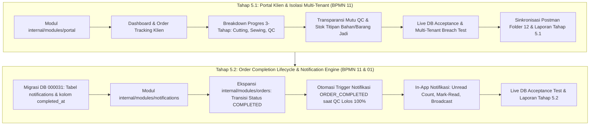

# Analisis & Rencana Pengerjaan Tahap 5: Portal Klien & Notifikasi (BPMN 11 & BPMN 01)

**Tanggal:** 15 Oktober 2026  
**Status:** Diterima & Disetujui sebagai Panduan Pengerjaan Tahap 5  
**Referensi Utama:** `urutan pengerjaan.txt`, `Lukla_BPMN_v2.drawio` (BPMN 11 & BPMN 01), serta Dokumen Spesifikasi Kebutuhan Sistem (SRS).

---

## 1. Analisis Keterlibatan Modul

Tahap 5 berfokus pada pembukaan antarmuka bagi klien eksternal dengan isolasi data multi-tenant yang ketat, serta pengaktifan sistem notifikasi kejadian (*event-driven notification engine*). Modul-modul yang terlibat meliputi:

### A. Modul Domain Baru:
1. **`internal/modules/portal` (Client Portal Gateway):**
   - Berfungsi sebagai antarmuka khusus pengguna eksternal dengan peran `client`.
   - Menegakkan **Multi-Tenant Isolation Mutlak**: Menyaring seluruh data pesanan, progres produksi, dan saldo stok secara otomatis berdasarkan klaim `client_id` pada token JWT (`actor.ClientID`). Klien Snøhund tidak dapat mengakses atau melihat data milik Klien Urban Culture atau klien lainnya.
   - Endpoint utama yang disediakan:
     - `GET /portal/dashboard`: Metrik ringkasan portal (order aktif, order selesai, barang jadi siap kirim, sisa material).
     - `GET /portal/orders`: Daftar pesanan milik klien (dengan filter status dan pencarian).
     - `GET /portal/orders/:id`: Detail pesanan dan breakdown progres per tahapan (Cutting $\to$ Sewing/Assembly $\to$ QC Lolos).
     - `GET /portal/orders/:id/quality`: Transparansi mutu hasil QC (kuantitas lolos, repair, reject, dan persentase *pass rate*).
     - `GET /portal/stocks/materials`: Saldo stok lot bahan baku titipan klien di gudang pabrik.
     - `GET /portal/stocks/finished-goods`: Saldo barang jadi yang telah lolos QC dan siap diambil/dikirim.

2. **`internal/modules/notifications` (In-App Notification Engine):**
   - Mengelola persistensi data notifikasi kejadian di database (tabel baru `notifications`).
   - Menyediakan pencatatan dan penghitungan notifikasi belum dibaca (*unread counter*).
   - Mendukung tipe kejadian (*event types*):
     - `ORDER_COMPLETED`: Pesanan selesai diproduksi dan lolos QC 100%.
     - `MATERIAL_RECEIVED`: Bahan baku kiriman klien telah diterima dan ditagging di gudang.
     - `PRODUCTION_MILESTONE`: Update milestone produksi (misal: pemotongan selesai, jahit dimulai).
     - `GENERAL_ANNOUNCEMENT`: Pengumuman/pesan manual dari tim internal pabrik ke klien.
   - Endpoint utama yang disediakan:
     - `GET /portal/notifications`: Daftar notifikasi klien + `unreadCount`.
     - `PUT /portal/notifications/:id/read`: Menandai satu notifikasi sebagai terbaca.
     - `PUT /portal/notifications/read-all`: Menandai seluruh notifikasi klien sebagai terbaca.
     - `POST /notifications/send`: Pengiriman notifikasi manual oleh tim internal (Owner / Kepala Produksi).

### B. Modul yang Diekspansi / Terintegrasi:
3. **`internal/modules/orders` (Ekspansi Modul):**
   - Pengelolaan transisi status pesanan dari `IN_PRODUCTION` menjadi `COMPLETED`.
   - Penambahan kolom timestamp penyelesaian: `completed_at TIMESTAMPTZ`.
   - Endpoint penutupan pesanan resmi internal: `POST /orders/:id/complete`.

4. **`internal/modules/quality` (Modul Terkait / Trigger Otomatis):**
   - Menjadi pemicu (*trigger*) otomatis: Ketika hasil inspeksi QC pada `qc_inspections` menyebabkan akumulasi produk lolos (`passed_quantity`) memenuhi target kuantitas order (`target_quantity`), sistem secara otomatis mengubah status order menjadi `COMPLETED` dan menghasilkan rekaman notifikasi `ORDER_COMPLETED`.

5. **`internal/modules/inventory` (Modul Terkait / Query Gateway):**
   - Menyediakan data inventaris bahan baku titipan per lot untuk disajikan secara terfilter pada portal klien.

6. **`internal/app` (Router, Middleware, & Security Guards):**
   - Registrasi rute `/api/v1/portal/*`, `/api/v1/notifications/*`, dan `/api/v1/orders/*`.
   - Middleware guard khusus `RequireClientRole` yang memastikan endpoint `/portal/*` hanya dapat diakses oleh akun klien, serta menolak akun klien mengakses endpoint internal pabrik.

---

## 2. Dokumen Kontrak API (OpenAPI Phase 5)

Kontrak spesifikasi antarmuka API lengkap untuk Tahap 5 telah disusun dan disimpan pada berkas:
📄 **`openapi-phase5-portal-klien.yaml`**

*(Berkas ini berada pada direktori utama backend dan mendefinisikan seluruh skema request, response, error handling, parameter query/path, serta komponen keamanan JWT untuk 13 endpoint Tahap 5).*

---

## 3. Analisis Keamanan Eksekusi & Rencana Sub-Tahapan

### Pertanyaan: Apakah aman jika langsung mengerjakan Tahap 5 ini sekaligus?
**Jawaban: TIDAK AMAN jika dikerjakan sekaligus dalam 1 tahap besar (*monolithic step*).**

### Alasan Teknis & Risiko:
1. **Risiko Keamanan Multi-Tenant (Gerbang Keputusan RLS):**
   Portal klien adalah antarmuka pertama yang diekspos kepada pihak eksternal (*external brand client*). Validasi isolasi data per `client_id` (klien tidak boleh melihat pesanan, bahan, atau lot milik klien lain) memerlukan pengujian keamanan (*breach test*) yang mendalam dan terisolasi sebelum diintegrasikan dengan logika mutasi status dan event notifikasi.
2. **Ketergantungan Event & Mutasi Database Bertingkat:**
   Sistem notifikasi bergantung pada event yang dihasilkan saat pesanan selesai atau saat material diterima di gudang. Jika skema notifikasi, otomasi order lifecycle, dan query portal dibangun secara serentak, pelacakan bug atau kegagalan transaksi (*rollback failure*) akan menjadi sangat kompleks.
3. **Kualitas Pengujian & Integritas Postman:**
   Pemisahan bertahap menjamin setiap langkah memiliki migrasi database yang bersih, unit test yang terisolasi, acceptance test live DB yang lulus 100%, serta sinkronisasi Postman Collection yang akurat dan dapat langsung diverifikasi.

---

### Rencana Sub-Tahapan yang Aman dan Tepat

Tahap 5 dibagi menjadi **2 sub-tahap terukur**:

#### **A. Rincian Pengerjaan Tahap 5.1: Portal Klien & Isolasi Multi-Tenant (BPMN 11)**
1. **Target Modul:** `internal/modules/portal`, `internal/app`.
2. **Ruang Lingkup Fitur:**
   - Endpoint ringkasan: `GET /api/v1/portal/dashboard`.
   - Endpoint pelacakan pesanan: `GET /api/v1/portal/orders` dan `GET /api/v1/portal/orders/:id`.
   - Endpoint transparansi mutu: `GET /api/v1/portal/orders/:id/quality`.
   - Endpoint inventaris titipan klien: `GET /api/v1/portal/stocks/materials` dan `GET /api/v1/portal/stocks/finished-goods`.
3. **Pengujian Kunci (Acceptance & Security Breach Test):**
   - Klien Snøhund hanya dapat melihat pesanan dan material miliknya.
   - Percobaan Klien Snøhund mengakses ID pesanan milik Klien Urban Culture ditolak tegas (`403 Forbidden` / `404 Not Found`).
   - Akun internal pabrik (non-klien) yang mengakses portal dialihkan atau ditolak sesuai RBAC.
4. **Luaran Tahap 5.1:**
   - Unit test & Live DB test 100% PASS.
   - Penambahan folder Postman: `12. Tahap 5.1: Portal Klien & Isolasi Multi-Tenant (BPMN 11)`.
   - Dokumen riwayat: `history-pengerjaan/tahap-5.1-portal-klien.md`.

---

#### **B. Rincian Pengerjaan Tahap 5.2: Order Completion Lifecycle & Notification Engine (BPMN 11 & 01)**
1. **Target Modul:** `internal/modules/notifications`, `internal/modules/orders`, `internal/modules/quality`, `internal/app`.
2. **Database Migration (Versi 31):**
   - Menambahkan kolom `completed_at` pada tabel `orders`.
   - Membuat tabel `notifications` (`id`, `client_id`, `title`, `message`, `event_type`, `reference_id`, `is_read`, `read_at`, `created_at`).
3. **Ruang Lingkup Fitur:**
   - Otomasi transisi status order menjadi `COMPLETED` saat akumulasi lolos QC mencapai target order.
   - Dispatcher notifikasi otomatis untuk event `ORDER_COMPLETED` dan `MATERIAL_RECEIVED`.
   - Endpoint in-app notifikasi portal: `GET /portal/notifications`, `PUT /portal/notifications/:id/read`, `PUT /portal/notifications/read-all`.
   - Endpoint manual order completion & broadcast: `POST /orders/:id/complete` dan `POST /notifications/send`.
4. **Pengujian Kunci:**
   - Verifikasi simulasi submit QC lolos mencapai target pesanan otomatis menutup order dan menerbitkan notifikasi ke klien.
   - Verifikasi operasi unread count dan penandaan baca.
5. **Luaran Tahap 5.2:**
   - Unit test & Live DB test 100% PASS.
   - Penambahan folder Postman: `13. Tahap 5.2: Order Completion & Notification Engine (BPMN 11 & 01)`.
   - Dokumen riwayat: `history-pengerjaan/tahap-5.2-order-completion-notifikasi.md`.

