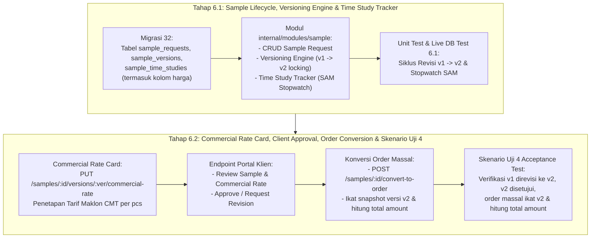

# Analisis & Rencana Pengerjaan Tahap 6: Sample, Time Study, Commercial Rate Card & Konversi Order Massal (BPMN 03)

**Tanggal Analisis:** 15 Oktober 2026  
**Status Tahap Sebelumnya:** Tahap 0 s.d. Tahap 5 telah selesai 100% dan terverifikasi di live database.  
**Referensi Utama:**
- Roadmap: `urutan pengerjaan.txt` (Tahap 6: BPMN 03, Skenario Uji 4)
- Diagram Proses Bisnis: `Lukla_BPMN_v2.drawio` (Diagram 3: Sample ke Order Massal & Diagram 11: Portal Klien)
- Dokumen Arsitektur: `Lukla_Operations_Engine_Architecture.md` (Bagian Sample, Time Study, Histori & Locking, Skenario Uji 4)
- Spesifikasi Kontrak API: [openapi-phase6-sample-time-study.yaml](../openapi-phase6-sample-time-study.yaml)

---

## 1. Analisis Kebutuhan Bisnis & Skenario Uji 4

Berdasarkan alur kerja operasional pabrik maklon garmen Lukla:
1. **Siklus Sample Baru (BPMN 03):**
   - Sebelum brand klien menerbitkan Purchase Order (PO) produksi massal ribuan potong, klien terlebih dahulu mengajukan pembuatan sample fisik prototipe artikel baru.
2. **Versioning Bertingkat (Immutable Audit Trail):**
   - Sample v1 dibuat dan diuji jahit oleh penjahit sample.
   - Sering kali sample v1 belum disetujui klien karena memerlukan penyesuaian (misal: posisi saku diubah, lingkar pinggang dilonggarkan, jenis resleting diganti).
   - Sistem wajib mendukung **versioning bertingkat** (`v1`, `v2`, `v3`):
     - Versi sebelumnya (`v1`) dikunci dengan status `REVISED` dan tidak boleh diubah lagi secara diam-diam.
     - Versi baru (`v2`) diterbitkan dengan membawa catatan perbaikan teknis.
3. **Time Study Tracker (Penetapan Standard SAM):**
   - Di setiap versi sample, tim IE/Produksi melakukan observasi *time study* per komponen jahit (menggunakan stopwatch, mencatat durasi detik observasi, allowance faktor %, dan menghitung Standard Allowed Minute / SAM).
   - Total SAM ini menjadi dasar perhitungan kapasitas lini produksi dan beban kerja riil per potong baju.
4. **Commercial Rate Card (Harga Jual Jasa Maklon per Artikel ke Klien - Disematkan di Tahap 6.2):**
   - Terdapat **2 jenis Rate Card** yang berbeda fungsi dalam arsitektur Lukla:
     1. *Internal Labor Rate Card (Tahap 0 / BPMN 10):* Tarif upah borongan kerja per komponen (`sewing_rate`, `cutting_rate`) yang dibayarkan pabrik kepada operator/penjahit.
     2. *Commercial Client Rate Card (Tahap 6.2 / BPMN 03 & 11):* Harga tagihan jasa maklon CMT (*Cut, Make, Trim*) per potong baju dari pabrik kepada klien brand (contoh: Rp 45.000 / pcs untuk Jaket Parka Snøhund).
   - **Korelasi dengan Time Study:** Berdasarkan total SAM yang dihitung pada versi sample tertentu, manajemen/owner dapat menetapkan harga maklon yang wajar dan menguntungkan (`proposed_unit_price`).
   - Harga ini dicantumkan pada spesifikasi versi sample, lalu diajukan ke klien melalui Portal Klien.
5. **Persetujuan Klien (Client Approval):**
   - Klien meninjau fisik sample, foto/dokumen revisi, dan penawaran harga komersial di Portal Klien.
   - Klien memberikan persetujuan digital (`APPROVED`) pada versi sample yang sudah sempurna (misalnya `v2`), yang sekaligus mengunci kesepakatan harga per potong tersebut.
6. **Konversi ke Order Massal (Skenario Uji 4):**
   - Skenario Uji 4 pada SRS menetapkan: **"Sample v1 direvisi ke v2, v2 disetujui, dan order massal merujuk spesifikasi yang benar."**
   - Saat sample yang berstatus `APPROVED` dikonversi menjadi PO produksi massal (`POST /samples/:id/convert-to-order`):
     - Sistem menjamin pesanan massal tersebut **secara absolut mengikat spesifikasi versi sample v2 yang disetujui** (bukan v1 yang sudah usang).
     - Sistem menyalin harga satuan maklon yang disetujui (`unit_price`) ke order massal dan menghitung nilai kontrak otomatis: $\text{total\_amount} = \text{target\_quantity} \times \text{unit\_price}$.

---

## 2. Modul-Modul yang Terlibat

| Modul | Peran & Tanggung Jawab dalam Tahap 6 |
|---|---|
| **`internal/modules/sample`** *(Modul Baru)* | Modul domain utama yang bertanggung jawab mengelola siklus hidup permintaan sample (`sample_requests`), versioning bertingkat (`sample_versions`), pencatatan observasi waktu per komponen (`sample_time_studies`), penetapan harga komersial ke klien (`proposed_unit_price`), dan status approval. |
| **`internal/modules/masterdata`** | Menyediakan data artikel (`articles`) dan komponennya (`components`). Nilai Standard SAM pada komponen artikel dapat disinkronkan secara otomatis dari hasil time study final sample yang disetujui. |
| **`internal/modules/order`** | Menerima aksi konversi dari sample yang berstatus `APPROVED` menjadi Order Produksi Massal (`orders`) dengan snapshot spesifikasi teknis dan pengikatan harga maklon (`unit_price` & `total_amount`) yang tepat (membuktikan Skenario Uji 4). |
| **`internal/modules/notification`** | Mengirimkan notifikasi in-app otomatis ke akun klien saat sample siap ditinjau (`SAMPLE_READY_FOR_REVIEW`), serta mengirim notifikasi ke tim produksi pabrik saat klien menyetujui (`SAMPLE_APPROVED`) atau meminta revisi (`SAMPLE_REVISION_REQUESTED`). |
| **`internal/modules/portal`** | Menyajikan endpoint portal bagi klien eksternal untuk melacak daftar sample milik mereka, melihat riwayat revisi, rincian penawaran harga komersial, dan mengeksekusi tombol persetujuan atau permintaan revisi secara aman dengan isolasi multi-tenant. |
| **`internal/app`** | Melakukan dependensi wiring antara `sample.Service`, `order.Service`, `notification.Service`, dan `portal.Service` pada router Gin engine. |

---

## 3. Analisis Keamanan & Rencana Pemecahan Tahapan

### Pertanyaan: Apakah aman jika langsung mengerjakan Tahap 6 ini sekaligus?
**Jawab: TIDAK AMAN jika dikerjakan sekaligus dalam satu langkah besar.**

### Alasan Risiko Teknis:
1. **Tingkat Kompleksitas Model Data Versioning:** Struktur data sample bersifat hierarkis (`sample_requests` $\to$ `sample_versions` $\to$ `sample_time_studies`). Alur duplikasi dan penguncian versi membutuhkan kueri transaksi database yang detail dan hati-hati.
2. **Ketergantungan Pembuktian Skenario Uji 4:** Skenario Uji 4 mewajibkan verifikasi mutlak bahwa versi v1 yang direvisi tidak boleh bocor ke order massal, dan hanya spesifikasi versi v2 yang dipakai. Jika dikerjakan sekaligus bersama commercial rate card, portal approval, dan notifikasi, pelacakan potensi *bug* menjadi bias dan sulit diisolasi.
3. **Ukuran File & Pengujian:** Mengerjakan sekaligus akan menghasilkan 13 endpoint baru, 2 file migrasi, dan ratusan baris test yang memperlambat verifikasi live DB.

---

### Rencana Pemecahan Tahapan yang Tepat & Bertahap

Untuk menjaga stabilitas, kualitas kode, dan keterlacakan pengujian, Tahap 6 dibagi menjadi **2 sub-tahap**:

---

### Rincian Sub-Tahap

#### **A. Tahap 6.1: Sample Lifecycle, Versioning Engine, & Time Study Tracker (BPMN 03)**
1. **Database Migration (Versi 32):**
   - `sample_requests`: `id`, `sample_code`, `client_id`, `article_id`, `status`, `target_date`, `created_at`.
   - `sample_versions`: `id`, `sample_request_id`, `version_number`, `version_label`, `status` (`DRAFT`, `IN_REVIEW`, `REVISED`, `APPROVED`, `REJECTED`), `revision_notes`, `client_feedback`, `total_sam`, `proposed_unit_price`, `currency`, `price_notes`, `approved_at`, `created_at`.
   - `sample_time_studies`: `id`, `sample_version_id`, `component_id`, `observed_seconds`, `allowance_percentage`, `calculated_sam`, `target_per_hour`, `operator_id`, `notes`.
2. **Implementasi Modul `internal/modules/sample`:**
   - `model.go`, `repository.go`, `postgres_repository.go`, `service.go`, `handler.go`.
   - API Internal:
     - `POST /samples`: Buat sample request baru & inisialisasi versi 1 (`v1`).
     - `GET /samples`: List sample request (filter status, clientId, search).
     - `GET /samples/:id`: Detail sample request beserta seluruh riwayat versi.
     - `POST /samples/:id/versions`: Buat versi revisi baru (`v1` $\to$ `v2`) dan kunci versi lama menjadi `REVISED`.
     - `POST /samples/:id/versions/:ver/time-studies`: Input data time study stopwatch per komponen.
     - `GET /samples/:id/versions/:ver/time-studies`: Rekapitulasi waktu SAM versi terkait.
     - `POST /samples/:id/submit-review`: Ajukan sample ke status `IN_REVIEW`.
3. **Pengujian Tahap 6.1:**
   - Unit test modul `sample`.
   - Live Database Acceptance Test untuk alur versioning `v1` $\to$ `v2` dan stopwatch SAM.
4. **Luaran Tahap 6.1:**
   - Postman Collection: Folder `14. Tahap 6.1: Sample & Time Study Engine (BPMN 03)`.
   - Dokumen riwayat: `history-pengerjaan/tahap-6.1-sample-time-study.md`.

---

#### **B. Tahap 6.2: Commercial Rate Card, Client Approval Portal, Konversi ke Order Massal, & Skenario Uji 4 (BPMN 03 & 11)**
1. **Commercial Rate Card Management:**
   - `PUT /samples/:id/versions/:ver/commercial-rate`: Manajemen menetapkan tarif jasa maklon CMT per pcs (`proposed_unit_price`) berdasarkan hasil total SAM.
2. **Fitur & Endpoint Portal Klien (Multi-Tenant & Anti-IDOR):**
   - `GET /portal/samples`: Klien melihat daftar sample miliknya beserta penawaran harga.
   - `GET /portal/samples/:id`: Klien melihat detail spesifikasi fisik, catatan revisi, dan breakdown tarif jasa maklon.
   - `POST /portal/samples/:id/approve`: Klien menyetujui sample versi aktif beserta harganya (`APPROVED`).
   - `POST /portal/samples/:id/request-revision`: Klien meminta revisi spesifikasi sample.
3. **Konversi ke Order Massal & Integrasi Finansial (`internal/modules/order`):**
   - `POST /samples/:id/convert-to-order`: Mengonversi sample approved menjadi Order Produksi Massal (`orders`).
   - Menyalin `proposed_unit_price` versi sample approved ke kolom `unit_price` tabel `orders`.
   - Menghitung nilai total PO: $\text{total\_amount} = \text{target\_quantity} \times \text{unit\_price}$.
   - Menghubungkan kolom `converted_order_id` pada `sample_requests`.
   - Menjamin secara mutlak bahwa order massal yang dibuat mengikat komponen dan SAM dari **versi sample yang disetujui (v2, bukan v1)**.
4. **Verifikasi Kunci Skenario Uji 4 (SRS Skenario 4):**
   - Membuat Sample v1 $\to$ Klien minta revisi $\to$ Terbit Versi v2 dengan komponen revisi dan penetapan Commercial Rate Card $\to$ Klien setujui v2 $\to$ Konversi ke Order Massal $\to$ Verifikasi snapshot order massal identik 100% dengan v2, harga satuan sesuai kesepakatan, dan total nilai order terhitung akurat.
5. **Luaran Tahap 6.2:**
   - Postman Collection: Folder `15. Tahap 6.2: Client Approval, Commercial Rate Card & Mass Order Conversion (BPMN 03 & Skenario Uji 4)`.
   - Dokumen riwayat: `history-pengerjaan/tahap-6.2-sample-approval-skenario4.md`.
