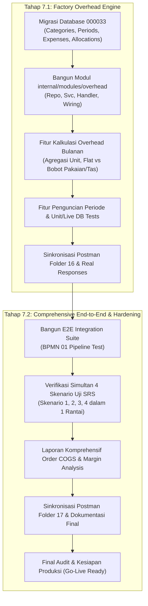

# Analisis & Rencana Pengerjaan Tahap 7: Biaya Overhead Pabrik & Pengujian End-to-End (BPMN 09 & 01)

**Tanggal Analisis:** 15 Oktober 2026  
**Status Tahap Sebelumnya:** Tahap 0 s.d. Tahap 6 telah selesai 100%, terverifikasi di live database, dan seluruh endpoint Postman telah memiliki contoh respon riil.  
**Referensi Utama:**
- Roadmap: `urutan pengerjaan.txt` (Tahap 7: BPMN 09, BPMN 01, Seluruh 4 Skenario Uji SRS Lulus)
- Diagram Proses Bisnis: `Lukla_BPMN_v2.drawio` (Diagram 9: Overhead Bulanan & Diagram 1: End-to-End Manufaktur)
- Dokumen Arsitektur: `Lukla_Operations_Engine_Architecture.md` (Costing Engine, Factory Overhead, COGS Reporting, dan Skenario Uji SRS 1–4)
- Spesifikasi Kontrak API: [openapi-phase7-overhead-e2e.yaml](../openapi-phase7-overhead-e2e.yaml)

---

## 1. Analisis Kebutuhan Bisnis & Aturan Operasional

### A. Factory Overhead Engine (BPMN 09 - FR-10.4)
1. **Latar Belakang Biaya Manufaktur:**
   - Dalam industri konveksi maklon garmen, biaya produksi tidak hanya terdiri dari upah penjahit langsung (*Direct Labor*) dan bahan baku (*Raw Material*).
   - Pabrik memiliki beban operasional utilitas dan fasilitas (*Factory Overhead*) yang dikeluarkan secara bulanan, antara lain:
     - Biaya listrik PLN (mesin jahit, mesin potong, kompresor angin, penerangan lini jahit).
     - Biaya air operasional & sanitasi workshop.
     - Biaya internet & utilitas telekomunikasi pabrik.
     - Biaya sewa bangunan/workshop pabrik.
     - Biaya pemeliharaan rutin mesin jahit & penggantian suku cadang (jarum, sekoci, pelumas mesin).
     - Biaya bahan pembantu umum (kertas pola, kapur jahit, plastik pelindung roll kain).
     - Biaya operasional non-produksi lainnya.
2. **Siklus Pembukuan Overhead Bulanan:**
   - Di akhir bulan, staf Finance / Accounting membuka periode overhead bulanan (misal: `OH-202610` untuk periode 1–31 Oktober 2026).
   - Tim Finance menginput seluruh transaksi pengeluaran aktual yang terjadi pada bulan tersebut beserta bukti nomor invoice/kuitansi.
3. **Agregasi Otomatis Unit Produksi Aktual:**
   - Sistem tidak memerlukan operator menginput total unit secara manual; engine secara otomatis melakukan kueri ke modul `quality` & `production` untuk menjumlahkan seluruh barang jadi yang lolos QC (`passed_quantity`) pada rentang tanggal bulan tersebut.
4. **Formula Alokasi Biaya Overhead per Unit:**
   - **Tarif Flat Standar:**
     $$\text{Overhead Per Unit} = \frac{\text{Total Biaya Overhead Bulanan}}{\text{Total Unit Lolos QC}}$$
   - **Opsi Pembobotan Kategori Produk (Pakaian vs Tas):**
     - Sesuai catatan pada diagram BPMN 09 ("TBC: unit pakaian dan tas dihitung sama?"):
     - Pembuatan tas ransel/carrier umumnya membutuhkan mesin *heavy duty*, waktu jahit lebih lama, dan konsumsi daya lebih besar dibandingkan pakaian/kaos standar.
     - Engine menyediakan parameter pembobotan rasio:
       $$\text{Unit Terbobot} = (Q_{\text{Garment}} \times W_{\text{Garment}}) + (Q_{\text{Bag}} \times W_{\text{Bag}})$$
       $$\text{Tarif Garment} = \frac{\text{Total Biaya}}{\text{Unit Terbobot}} \times W_{\text{Garment}}, \quad \text{Tarif Bag} = \frac{\text{Total Biaya}}{\text{Unit Terbobot}} \times W_{\text{Bag}}$$
       *(Default bobot: Garment = 1.0, Bag = 1.25, atau seragam jika tidak diubah)*.
5. **Penguncian Periode (*Locking Period*):**
   - Setelah rekonsiliasi bulanan disetujui Owner / Finance Head, periode dikunci (`LOCKED`).
   - Periode yang terkunci bersifat *immutable*: tidak boleh ada penambahan pengeluaran baru atau kalkulasi ulang agar integritas laporan keuangan bulanan terjamin.
6. **Laporan HPP / COGS Komprehensif per Order:**
   - Mengintegrasikan seluruh elemen biaya manufaktur riil per order:
     $$\text{COGS Order} = \text{Total Upah Jahit CMT} + \text{Pool Bonus QC} + (\text{Overhead Per Unit} \times \text{Unit Diproduksi})$$
   - Membandingkan total COGS dengan nilai kontrak maklon (`total_amount = target_quantity * unit_price`) untuk menghitung Margin Laba Kotor pabrik (*Gross Profit Margin*).

---

### B. Comprehensive End-to-End Testing & Verifikasi 4 Skenario Uji SRS (BPMN 01)
BPMN 01 adalah diagram alur hidup manufaktur terintegrasi dari hulu ke hilir. Pada Tahap 7 ini, seluruh 11 modul operasional diuji secara berkesinambungan dalam satu skenario terpadu:
1. **Skenario Uji 1 (Gudang & Blokade - BPMN 02):**
   - Penerimaan lot kain bertagging Client ID Snøhund.
   - Verifikasi blokir kontaminasi silang saat bahan Snøhund coba dikeluarkan untuk order Aventura (sistem menolak dengan peringatan tegas).
   - Pengeluaran bahan ke cutting order Snøhund dan pencatatan scrap.
2. **Skenario Uji 2 (Lantai Produksi & Payroll Mingguan - BPMN 04, 05, 07):**
   - Alokasi penjahit ke lini jahit.
   - Penjahit baru masuk di tengah minggu (Rabu).
   - Input ritme output jahit tiap 30 menit oleh mandor.
   - Perhitungan payroll mingguan: upah borongan sesuai output riil + uang makan dihitung proporsional 4 hari kerja (Rabu–Sabtu).
3. **Skenario Uji 3 (Inspeksi Kualitas & Pool Bonus QC - BPMN 06, 08):**
   - Pemeriksaan hasil rakitan di stasiun QC, pencatatan lolos, repair, reject, dan tagging defect.
   - Pencapaian 3.000 pcs pakaian lolos QC mengumpulkan pool bonus Rp 1.500.000 (tarif Rp 500/pcs).
   - Kalkulasi pool bonus dibagi rata secara adil kepada 3 personel QC (masing-masing Rp 500.000).
4. **Skenario Uji 4 (Sample, Versioning & Order Conversion - BPMN 03, 11):**
   - Inisiasi sample v1, permintaan revisi dari klien di portal, penerbitan sample v2 dengan revisi saku.
   - Penetapan Commercial Rate Card Rp 45.000/pcs pada v2.
   - Klien menyetujui versi 2 secara digital di portal.
   - Konversi sample v2 approved menjadi Order Produksi Massal 2.000 pcs mengikat harga Rp 45.000 (kontrak Rp 90.000.000).
5. **Integrasi Akhir dengan Overhead (BPMN 09):**
   - Order massal yang selesai dikaitkan dengan tarif alokasi overhead bulanan untuk menghasilkan laporan COGS dan laba kotor final.

---

## 2. Analisis Modul yang Terlibat

| Modul | Peran & Tanggung Jawab dalam Tahap 7 |
|---|---|
| **`internal/modules/overhead`** *(Modul Baru)* | Modul domain utama baru untuk mengelola master kategori pengeluaran pabrik (`overhead_categories`), periode overhead bulanan (`overhead_periods`), rincian pengeluaran aktual (`overhead_expenses`), engine kalkulasi tarif overhead flat vs terbobot, penguncian periode, dan laporan alokasi biaya. |
| **`internal/modules/quality`** | Menyediakan data agregasi unit produksi yang berhasil lolos QC (`passed_quantity`) sebagai pembagi volume produksi bulanan. |
| **`internal/modules/production`** | Menyediakan data unit rakitan jahit (`quantity_assembled`) dan lini produksi untuk analisis pemakaian utilitas. |
| **`internal/modules/order`** | Sumber data order produksi massal, status penyelesaian order, kuantitas target vs aktual, serta target entitas laporan COGS. |
| **`internal/modules/payroll`** | Menyediakan komponen biaya tenaga kerja langsung (Direct Labor) untuk perhitungan COGS per order. |
| **`internal/modules/qcbonus`** | Menyediakan komponen biaya insentif kualitas mutu (QC Bonus) untuk perhitungan COGS per order. |
| **`internal/modules/masterdata`** | Menyediakan klasifikasi kategori artikel (`GARMENT` vs `BAG`) untuk perhitungan pembobotan alokasi overhead. |
| **`internal/modules/inventory`** | Terlibat dalam pengujian E2E (Skenario 1: penerimaan lot, tagging client, blokade kontaminasi, dan scrap). |
| **`internal/modules/sample`** | Terlibat dalam pengujian E2E (Skenario 4: sample v1 -> v2, time study, commercial rate card, dan konversi order). |
| **`internal/modules/portal`** | Terlibat dalam pengujian E2E (digital approval klien, pelacakan progres real-time, dan status penyelesaian). |
| **`internal/modules/notification`** | Terlibat dalam pengujian E2E (notifikasi order selesai dan notifikasi audit finansial). |
| **`internal/app`** | Dependensi wiring untuk modul overhead pada Gin engine, middleware otentikasi/RBAC, dan orkestrasi acceptance test suite E2E komprehensif. |

---

## 3. Analisis Keamanan & Rencana Pemecahan Tahapan

### Pertanyaan: Apakah aman jika langsung mengerjakan Tahap 7 ini sekaligus?
**Jawab: TIDAK AMAN jika dikerjakan sekaligus dalam satu langkah monolitik.**

### Alasan Teknis & Risiko:
1. **Dua Ranah Pekerjaan yang Sangat Berbeda Karakter:**
   - Ranah 1 adalah **Pembangunan Fitur Baru (Factory Overhead Engine)** yang membutuhkan migrasi skema database baru (Migrasi 33), layer model, repository, service, handler, serta unit tests tersendiri.
   - Ranah 2 adalah **Pengujian Integrasi Komprehensif End-to-End (BPMN 01)** yang menguji keharmonisan interaksi seluruh 11 modul yang telah dibangun dari Tahap 0 hingga Tahap 7, serta memvalidasi ke-4 skenario uji SRS secara simultan.
2. **Sulitnya Melakukan Isolasi Masalah (*Root Cause Analysis*):**
   - Jika kedua ranah digabung dan terjadi kegagalan test pada pipeline E2E, tim akan kesulitan mendiagnosis apakah kegagalan tersebut akibat bug pada modul overhead yang baru dibuat, inkonsistensi data antar modul lama, atau kesalahan pada skrip assertion E2E.
3. **Risiko Regresi Kode (*Breaking Existing Suites*):**
   - Memasukkan modul baru dan E2E test raksasa sekaligus dapat mengaburkan visibilitas terhadap regresi pada 19 package backend yang saat ini sudah berstatus 100% PASS.

---

### Rekomendasi Rencana Tahapan yang Aman & Terstruktur:

#### Tahap 7.1: Factory Overhead Engine & Monthly Cost Allocation (BPMN 09)
- **Fokus:** Membangun fondasi engine overhead pabrik, pencatatan pengeluaran aktual bulanan, agregasi unit produksi otomatis, kalkulasi tarif overhead flat vs terbobot pakaian/tas, penguncian periode (*locking*), serta pelaporan biaya overhead bulanan.
- **Deliverables:**
  1. Migrasi database `000033_create_overhead_tables.up.sql` dan `.down.sql`.
  2. Paket modul Go `internal/modules/overhead` (model, repository, service, handler, unit tests).
  3. Integrasi wiring pada `internal/app`.
  4. Pengujian live database test untuk modul overhead.
  5. Sinkronisasi Postman Collection **Folder 16: Tahap 7.1 - Factory Overhead Engine** dengan respon riil pengujian.
  6. Laporan dokumentasi [history-pengerjaan/tahap-7.1-overhead-engine.md](./tahap-7.1-overhead-engine.md).

#### Tahap 7.2: Comprehensive End-to-End Testing, 4 SRS Scenarios Acceptance & Hardening (BPMN 01)
- **Fokus:** Membangun test suite integrasi end-to-end yang memvalidasi pipeline manufaktur lengkap (Sample -> Gudang -> Produksi -> QC -> Pool Bonus -> Payroll -> Portal -> Overhead -> COGS Reporting) serta membuktikan ke-4 skenario uji SRS lulus secara terpadu.
- **Deliverables:**
  1. Test suite E2E komprehensif pada `internal/app/e2e_full_pipeline_test.go`.
  2. Implementasi endpoint laporan COGS/HPP per order (`GET /api/v1/reports/cogs/:orderId`).
  3. Sinkronisasi Postman Collection **Folder 17: Tahap 7.2 - End-to-End Pipeline & COGS Report**.
  4. Laporan dokumentasi [history-pengerjaan/tahap-7.2-end-to-end-hardening.md](./tahap-7.2-end-to-end-hardening.md).
  5. Pembaruan [history-pengerjaan/README.md](./README.md) menandai seluruh roadmap implementasi selesai 100%.

